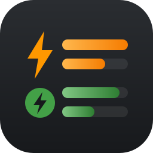
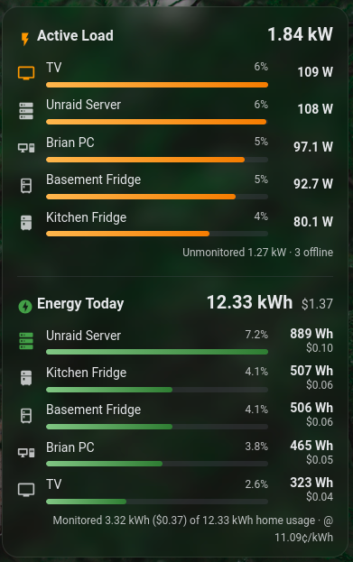

# Power & Energy Card

A Home Assistant dashboard card that shows where your power is going, right now and today.



- **Active Load**: your biggest loads by live power, each with a bar, its share of whole-home load, the unmonitored remainder and how many devices are offline.
- **Energy Today**: your biggest loads by energy used since midnight, with optional cost.

Loads are added in the visual editor: click **+ Add load**, pick a power sensor from the drop-down, done.

## Why it's different

**No helpers needed for "energy today".** Pick a load's *power* sensor and the card finds the lifetime energy sensor on the same device (e.g. ZHA `*_summation_delivered`, Shelly `*_energy`). It then reads today's usage from Home Assistant's long-term statistics. You don't need a `utility_meter` per device.

## Installation

### HACS (recommended)

1. HACS → ⋮ (top right) → **Custom repositories**
2. Repository: `https://github.com/duck-duck-dude/HA-power-energy-card`, Type: **Dashboard** → Add
3. Search HACS for **Power & Energy Card** → Download
4. Reload the browser when HACS asks

### Manual

1. Copy `dist/ha-power-energy-card.js` to `/config/www/`
2. Settings → Dashboards → ⋮ → Resources → Add `/local/ha-power-energy-card.js` (JavaScript module)

## Using it

Edit a dashboard → **Add card** → search **Power & Energy Card**.

In the editor:

| Setting | What it does |
|---|---|
| Whole-home power | Optional. Total house load (W or kW). Enables "% of home" and the unmonitored remainder. |
| Whole-home energy today | Optional. A sensor that **resets daily** (e.g. Powerwall/Tesla home usage). Shown as-is. |
| Electricity rate | Optional. Price per kWh. Cost = kWh × rate. |
| Loads to show | How many loads appear in each section (default 5). |
| Show cost | Hide or show cost when a rate is set. |
| Appearance | Section titles, and hide either section. |

**Loads:** click **+ Add load** and pick a power sensor. Each load row has:
- ✏️ **Edit**: set a display name or icon, or pick a different energy sensor. The editor shows which energy sensor was found automatically, or warns if none was found.
- 🗑 **Remove**

## YAML

```yaml
type: custom:power-energy-card
home_power: sensor.home_load_power        # optional
home_energy: sensor.home_usage_today      # optional, daily-resetting
rate: sensor.electricity_rate             # optional, price per kWh
top_n: 5                                  # default 5
show_cost: true                           # default true
show_load: true                           # default true
show_energy: true                         # default true
load_title: Active Load                   # default
energy_title: Energy Today                # default
loads:
  - entity: sensor.fridge_plug_power      # required: a power sensor
    name: Kitchen Fridge                  # optional, defaults to the device name
    icon: mdi:fridge                      # optional
    energy: sensor.fridge_plug_energy     # optional, overrides auto-detection
  - sensor.tv_plug_power                  # shorthand: just the entity
```

## How "Energy Today" is calculated

For each load, the card asks Home Assistant's recorder for the change in the energy sensor's statistics since local midnight. That's the same data the built-in Statistic card and Energy dashboard use. Between the 5-minute statistics updates it adds the sensor's live increase on top, so the numbers keep moving.

Requirements:
- The energy sensor must have `state_class: total_increasing` (or `total`) and an energy unit (Wh/kWh/MWh). Almost all smart plugs qualify.
- Statistics start when the sensor is first recorded, so a brand-new device shows from the next 5-minute statistics run.
- If a device has no energy sensor, the load still appears in **Active Load** but not in **Energy Today**. Point `energy:` at any energy sensor (a Riemann-sum integral helper works) to fix that.

Things to watch for:
- Don't add the same physical device twice (e.g. a Shelly added through both the Shelly and Matter integrations). It would be counted twice.
- Don't add a sensor that's a subset of another load (e.g. a server's CPU power sensor *and* the plug the server is on).

## License

MIT
